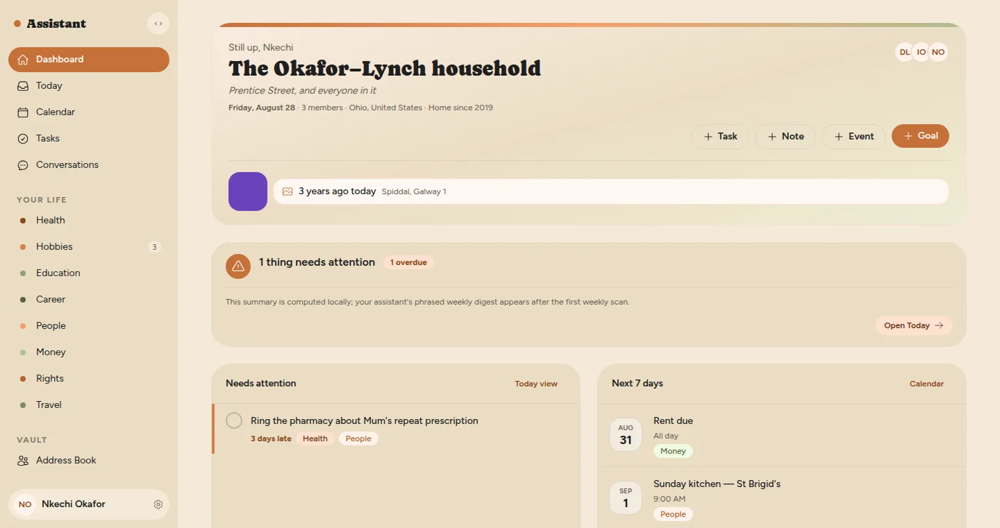
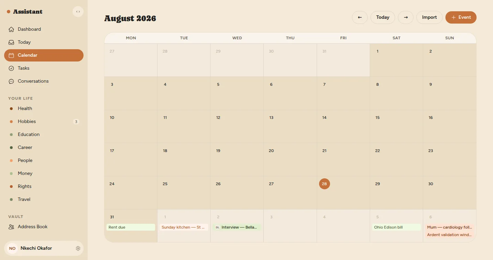
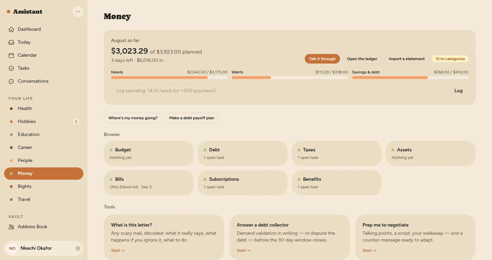
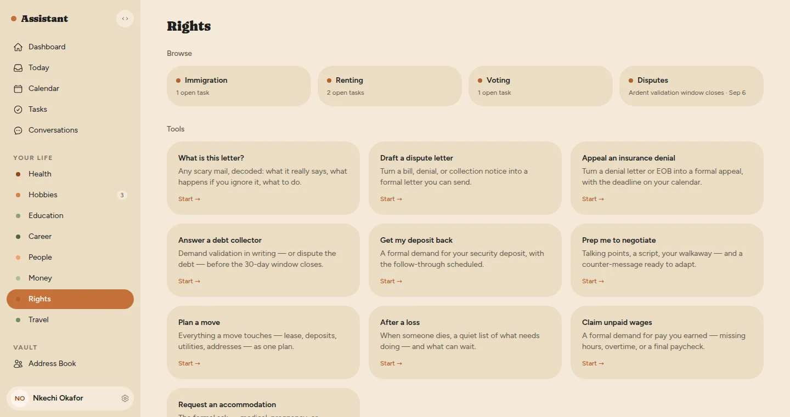
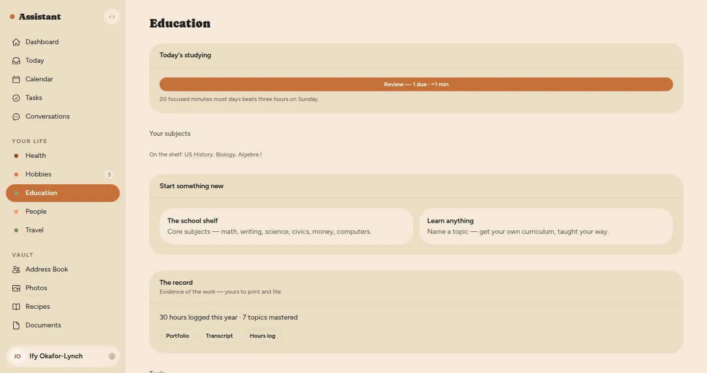
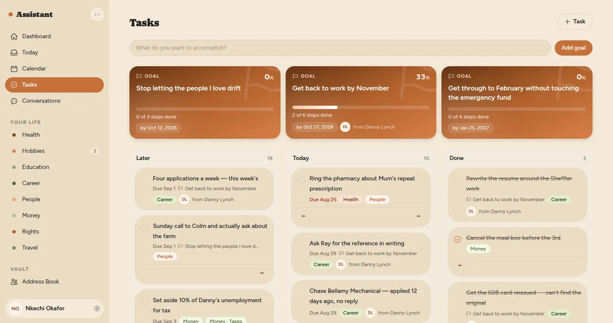
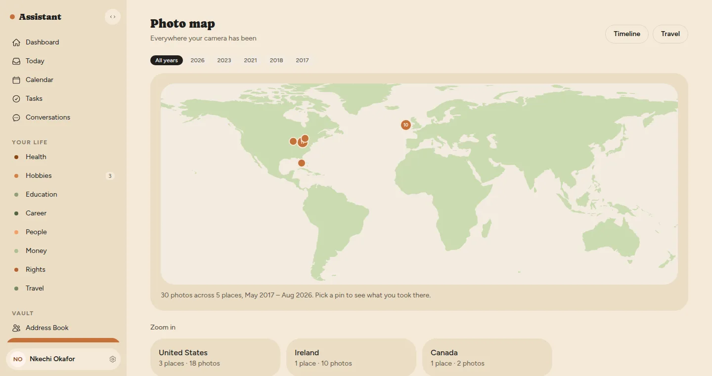

# Assistant *(working title)*

**An open-source AI life assistant that a household runs on its own computer.**

People with money have help: an assistant who keeps the calendar, an accountant who reads the letters, a lawyer who writes the difficult one back. This project is that stack of help as software you install at home — a private place for a whole household's life (appointments, tasks, documents, money, health, people), with an AI model of your choosing doing the reading and writing on top of it.



<sub>Every screenshot in this README shows a fictional demo family, seeded with `bin/rails demo:seed`.</sub>

## Why it exists

If AI assistance only ever arrives as a subscription from a few large companies, its benefits concentrate there too: you rent the help, they read your life, and the terms are theirs to change. Policies can be repealed and companies can switch products off, but software that people run on hardware they already own is very hard to take back.

So this is built to be **owned** rather than rented:

- **Self-hosted.** One installation serves one household. There is no account to make, no server of ours, no telemetry, and no paid tier.
- **Model-agnostic, local-first.** The app is built *around* a model, not on one. Point it at a model you run at home (Ollama, llama.cpp, LM Studio) or at a hosted provider; the settings page argues for the first and one switch removes the second.
- **Useful before it's clever.** With no model configured at all it is still a complete organiser — calendar, documents, tasks, people, photos — and every AI feature says plainly that it's off rather than guessing.
- **For people who've never had the help.** The target user is the household that doesn't already have an assistant, an accountant and a lawyer — not power users or enterprises.

The full argument is in [docs/VISION.md](docs/VISION.md).

## What it does

The app works in three layers, built in this order:

1. **Organize** — an owned record of your life, valuable with no AI at all.
2. **Tools** — specific jobs with a form and an answer: *read this pay stub*, *appeal this insurance denial*, *get my deposit back*, *plan my job search*. There are over fifty.
3. **Agent** — the app comes to you: what needs attention this week, the renewal next month, a drafted reply waiting for one click. How proactive it is can be dialled per area.

### Ten areas of life

Each area can be switched off if it isn't yours. They aren't separate apps: everything lives in one shared pool and an area is a view over it, so *Mom's cardiology appointment* is a Health thing and a People thing at once and appears in both.

| Area | What it covers |
|---|---|
| **Health** | Appointments, results explained in plain language, insurance and appeals, and a care radar for everyone in the house |
| **Money** | Budget, a spending ledger, debt payoff, taxes, bills, subscriptions, and a screener for benefits you may be missing |
| **Career** | Job search, interview prep and mock interviews, pay stub checks, offers, raises and negotiation |
| **Education** | A personal school per learner: subjects, evidence-based mastery, spaced-repetition review, a tutor, and homeschool records |
| **People** | The circle you'd regret losing touch with, group planning, gift ideas, and help with the hard conversations |
| **Rights** | Renting, immigration, voting and disputes — decode a letter, then draft the formal one back |
| **Hobbies** | A feed reader sorted into your hobbies, and an event radar for things nearby you'd actually go to |
| **Travel** | A world map drawn from your own geotagged photos, and trip planning with stays and transport |
| **Pets** | Each pet's records, vaccinations and vet visits, and a food shelf that knows when to reorder |
| **Food** | The recipe box, a shared shopping list, the fridge, the week's meal plan, and what to make from what's in |

### Across all of them

- **Dashboard, calendar and Today** — one view of what's due across every area, and one calendar for a whole life.
- **Tasks and goals** — day-sized tasks on a board, and big goals ("get a job") broken down into them.
- **Documents** — upload a lease or a photo of a vet report; the app reads it, summarises it, and proposes the appointments, bills and records it implies. Nothing is saved until you confirm.
- **Email** — your mailboxes mirrored onto your own disk, triaged, with deadlines surfaced.
- **Photos, recipes, notes and chat** — chat is for when a form is the wrong shape, and it has already read your files.
- **A password vault and a diary** — both encrypted with keys derived from each person's login password, so the database file alone reveals nothing, even to the admin.

<table>
  <tr>
    <td><br><sub>One calendar across every area</sub></td>
    <td><br><sub>Money: spent against planned, no bank connected</sub></td>
  </tr>
  <tr>
    <td><br><sub>Rights: a collections letter with a window still open</sub></td>
    <td><br><sub>Education: a learner's subjects and what they've mastered</sub></td>
  </tr>
  <tr>
    <td><br><sub>A goal's steps filed among ordinary tasks</sub></td>
    <td><br><sub>Travel: where you've been, from your own photos</sub></td>
  </tr>
</table>

## Privacy model

- **Private from your own household by default.** Everyone in the house gets their own account, and nothing one person keeps is visible to another — the admin included — until they share it, either one item at a time or a whole area ("share everything I file under Money with my spouse"). Every share is listed in one place and revocable. There are no hidden defaults.
- **Your data is files.** One SQLite database and a folder of attachments. Backing up is copying them.
- **The network is opt-in.** Anything that reaches outside the house — a hosted model, a mailbox, feeds, linked calendars and contacts, local event listings, phone alerts, outside file storage — is off until you set it up, and the app's own privacy page ([source](app/views/about/topics/_privacy.html.erb)) lists every one.
- **The public pages know nothing about you.** Each installation serves a set of `/about` pages explaining the app; they are identical on every install and read no household data, and one checkbox turns them off.

## How it's built

**Rails 8.1 · Ruby 3.3 · SQLite · Solid Queue / Cache / Cable · Hotwire (Turbo + Stimulus) · Tailwind CSS v4 · ViewComponent · Minitest · Docker / Kamal.** No Node, no Redis, no Postgres, and no external services required — the whole app is one process and a few SQLite files, so it fits on a mini PC.

A few design decisions worth knowing about:

- **Areas are views, not silos.** There is one shared pool of records — events, tasks, documents, people, goals, notes, plus photos, recipes, pets and so on — and the ten areas are tags over it. Areas live in a database table, not code, so a pet or a hobby can own its own view without a new silo.
- **One model adapter.** Every provider (OpenAI, Anthropic, Google, a router, or any OpenAI-compatible endpoint such as Ollama) goes through a single chat-completions client. Provider quirks are configuration, never a second code path.
- **The model classifies; code never guesses.** When the question is *what is this about*, the app asks the model — batched, over a bounded set, and validated against rows that already exist. Keyword matching is never used to decide what something *is*. Deterministic work (dates, arithmetic, parsing, search) stays deterministic.
- **Nothing lands without a click.** AI output — an intake proposal, a drafted letter, an agent suggestion — is staged for review; the user confirms before anything is written.
- **Untrusted input is treated as hostile.** Email, feeds and stranger web pages are parsed defensively and fetched with size and redirect caps and a block on private network addresses; the email and feed designs each carry their own threat model.
- **Decisions are written down.** Every real design decision, including the reversed ones, is a file in [docs/decisions/](docs/decisions/), and the build log is in [docs/status/](docs/status/).

## Running it

### From source

Requires Ruby 3.3 and SQLite.

```bash
git clone https://github.com/drusepth/assistant.git
```

```bash
cd assistant && bin/setup
```

`bin/setup` installs gems, creates and seeds the database, and starts the app (with the Tailwind watcher) at <http://localhost:3000>. Afterwards, `bin/dev` starts it again.

To explore with the fictional demo family instead of an empty house:

```bash
bin/rails demo:seed
```

Then sign in as `kay@example.com` with password `demo-password-1234`.

### With Docker

The image carries everything; no Ruby needed on the host. The volume holds the databases and attachments, so it is the thing to back up.

```bash
docker build -t assistant .
```

```bash
docker run -d -p 80:80 -v assistant-storage:/rails/storage -e SECRET_KEY_BASE=$(openssl rand -hex 64) --name assistant assistant
```

The database is created and migrated on boot. Keep the same `SECRET_KEY_BASE` across restarts, or everyone gets signed out.

### On a server

The repository includes a [Render blueprint](render.yaml) (Docker, with a persistent disk for the SQLite files) and a [Kamal config](config/deploy.yml) for a machine you rent or own.

### First run

The first visit to a fresh install asks you to name the household and create the admin account. A short walkthrough then asks which areas you want, and — for the admin — which model to use (skippable; the app works without one). Invite the rest of the household from Settings: invitations are copyable join links, so no mail server is needed.

### Connecting a model

In **Settings**, under **AI model**, pick a provider. For a model on your own hardware, install [Ollama](https://ollama.com) (or LM Studio, or llama.cpp), pull a model, choose **Local or self-hosted endpoint**, and enter its address (for Ollama, `http://localhost:11434/v1`) and the model name. A recent machine with 16 GB of memory runs a small model well enough for most of the app; the app's models page ([source](app/views/about/topics/_models.html.erb)) has the longer, honest version, including where a home model is worse.

### Tests

```bash
bin/rails test
```

```bash
bin/rubocop
```

## Status

Actively built. A great deal works and is in daily use; some areas are newer than others; the roadmap is public. The name is a working title.

## Documentation

- [docs/VISION.md](docs/VISION.md) — mission and strategy
- [docs/PRODUCT.md](docs/PRODUCT.md) — section-by-section product design
- [docs/ARCHITECTURE.md](docs/ARCHITECTURE.md) — schema, visibility model, model adapter
- [docs/ROADMAP.md](docs/ROADMAP.md) — the Tools and Agent milestones
- [docs/DESIGN.md](docs/DESIGN.md) — design system: tokens, atoms, components
- [docs/DECISIONS.md](docs/DECISIONS.md) — the decision log (read it with `bin/decisions`)
- [docs/STATUS.md](docs/STATUS.md) — what's next, and the build log (read it with `bin/status`)

Each feature area also has its own plan in `docs/` — for example [the password vault](docs/PASSWORDS_PLAN.md), [email](docs/EMAIL_PLAN.md), [document intake](docs/INTAKE_PLAN.md) and [education](docs/EDUCATION_PLAN.md).
